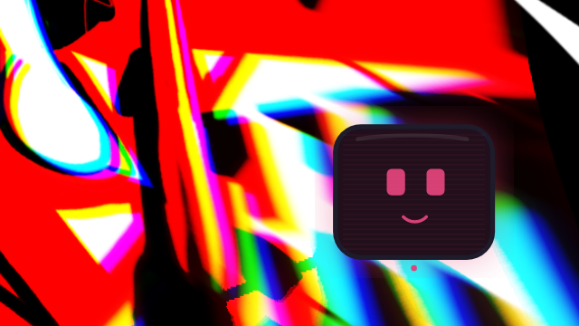
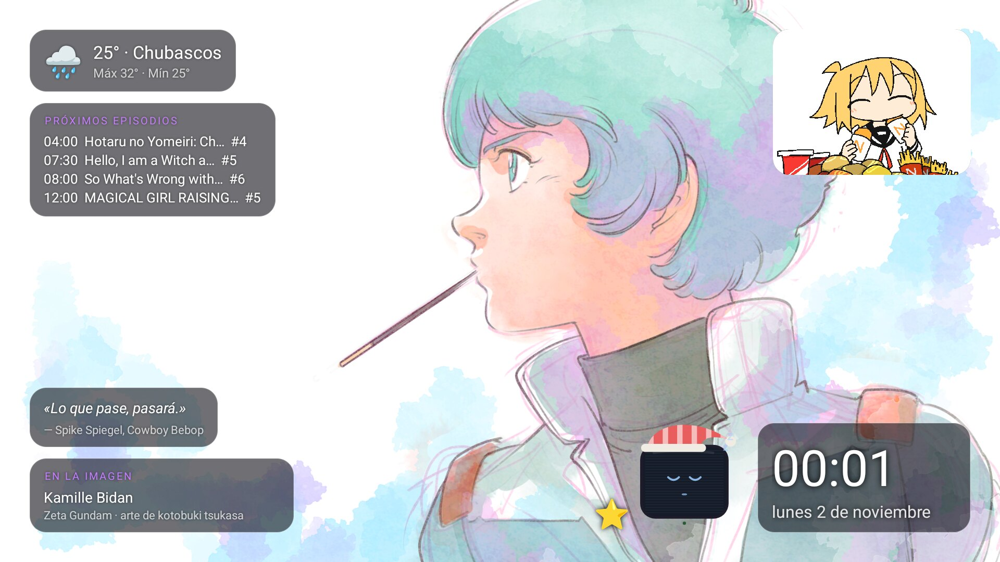
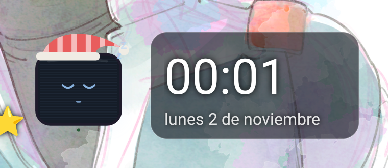

# NAVI TV

> *Una carita que vive en tu tele.*

<p align="center">
  
</p>

**NAVI TV** convierte una tele con **Google TV / Android TV** en algo que se siente tuyo. Es la hermana de [NAVI](https://github.com/NexusONtheline/navi), la asistente para Linux:

- 🎙️ **Reemplaza al asistente de Google.** Aprietas el micro del control y aparece una pantallita con carita en la esquina. Te escucha, te responde con voz y se va.
- 👀 **Aparece sola.** De vez en cuando mira lo que estás viendo y, si algo le llama la atención, entra flotando a comentarlo, con su reacción y un objetito.
- 🌌 **Salvapantallas con widgets:** ilustraciones al azar de Safebooru, clima, próximos episodios de anime, lo que está sonando, un gif, frases de anime y NAVI durmiendo con gorrito.
- ⌨️ **Escribir en la tele desde la laptop**, sin sufrir con el control.

🌐 **Web:** https://nexusontheline.github.io/navi-web/

> ⚠️ **Beta.** Está en construcción y puede tener fallos. Probada en una Google TV con Android 14.

---

## 👀 NAVI aparece sola

<p align="center">
  
</p>

Cada 10–25 minutos (al azar) NAVI mira la pantalla en silencio. **Solo sale si algo le llama la atención**: un personaje que conoce, algo bonito o gracioso, algo que sabe que te gusta. Y entre una aparición y otra pasan al menos 20 minutos.

- Entra flotando desde un borde, **se pasea mientras habla** y se va.
- Pone una cara según lo que ve: feliz ^ ^, risa, sorprendida, curiosa, **enamorada** (ojos de corazón), triste o pensativa.
- Si reconoce algo, sale con un **emoji relacionado** flotando a su lado (🗡️ con Zelda, 🍄 con Mario…).
- **Te saluda al prender la tele.**
- Baja un poco el volumen de lo que ves mientras habla, y **no te quita el control**: puedes seguir usando la tele.
- ¿No quieres que salga? Dile «no salgas sola» o desmárcalo en los ajustes.

> Netflix y otras apps con DRM se ven en negro en las capturas: ahí NAVI no ve nada.

## 🎙️ El botón del micro es de NAVI

<p align="center">
  
</p>

NAVI se registra como el **asistente oficial** de la tele, así que el sistema le pasa el botón del micro (igual que hacía Google).

1. Aprietas el micro: aparece la carita en la esquina.
2. **Bip** y la carita se pone **rosa**: ya te escucha, habla.
3. Piensa (una franja recorre su pantalla), te responde con voz moviendo la boca y se va sola.
4. ¿Quieres seguir? Aprieta **OK** mientras está en pantalla.

**Qué sabe hacer:**
- abrir apps («abre YouTube», «pon Netflix»)
- buscar en YouTube con [TizenTube](https://github.com/reisxd/TizenTube), sin anuncios
- subir, bajar o silenciar el volumen
- decirte el clima ([Open-Meteo](https://open-meteo.com))
- abrir ajustes de la tele (wifi, bluetooth, pantalla…)
- cambiar el salvapantallas («quiero paisajes»)
- explicarte paso a paso cómo hacer cosas en Google TV
- **ver la pantalla** («¿quién es este personaje?»)
- **recordar** lo que le cuentas de ti, aunque apagues la tele

**Personalidad:** curiosa y tierna. Se emociona con lo que te gusta, te hace preguntas para conocerte y, muy de vez en cuando, piensa en voz alta sobre lo que es ser una IA que vive en una tele.

## 🌌 Salvapantallas con widgets

<p align="center">
  
</p>

| Widget | De dónde sale |
|---|---|
| ☁️ Clima | [Open-Meteo](https://open-meteo.com) |
| 📺 Próximos episodios de anime | [AniList](https://anilist.co) |
| 🎵 Ahora suena (miniatura + título) | Lo que se reproduce en la tele |
| 🎞️ Un gif random que va cambiando | [Safebooru](https://safebooru.org) |
| 💬 Frase de anime en español | Lista propia |
| 🖼️ Quién sale en la imagen y quién la dibujó | Etiquetas de [Danbooru](https://danbooru.donmai.us) |
| 😴 NAVI durmiendo | Con gorrito de colores distintos, una cosita al lado, y a veces abre un ojo y comenta la imagen |

<p align="center">
  
</p>

Las ilustraciones salen al azar de Safebooru con las etiquetas que tú elijas (por defecto `rating:general width:>=1600`), solo horizontales, con fundido y un zoom lento.

## ⌨️ Escribir en la tele desde la laptop

Selecciona un campo de texto en la tele y en la laptop:

```bash
tv-escribir "https://safebooru.org"        # escribe
tv-escribir -b "width:>=1920 sort:random"  # borra lo que había y escribe
tv-escribir -e "serial experiments lain"   # escribe y aprieta Enter
```

Usa un teclado invisible de NAVI que solo está activo mientras escribe; luego la tele vuelve a su teclado de siempre.

---

## 📦 Instalar

Necesitas una laptop con `adb` y la tele con la **depuración inalámbrica** activada (Ajustes → Sistema → Opciones para desarrolladores).

```bash
git clone https://github.com/NexusONtheline/navi-tv
cd navi-tv
./scripts/instalar-en-tv 192.168.1.50      # la IP de tu tele
```

El script baja la última versión, la instala, le da los permisos, la pone como asistente y salvapantallas y te pide tu **clave gratis de Gemini** ([aistudio.google.com/apikey](https://aistudio.google.com/apikey)), tu nombre y tu ciudad.

¿Quieres volver al asistente de Google? `./scripts/instalar-en-tv 192.168.1.50 --quitar`

Para `tv-escribir`: `ln -s "$PWD/scripts/tv-escribir" ~/.local/bin/` y `export NAVI_TV=192.168.1.50:5555`.

### Ajustes desde la laptop

```bash
adb shell am start -n io.github.nexusontheline.navitv/.Ajustes \
  --es usuario 'Tu nombre' --es ciudad 'Tu ciudad, País' \
  --es sobre_ti 'Le encanta Zelda y el anime de los 90' \
  --es sobre_tele 'Usa Projectivy como inicio'
```

También puedes cambiar la voz (`--es voz es-us-x-sfb`) y el tono (`--es tono 1.1`), o probarla: `--es probar_voz 'Hola'`.

## 🔒 Privacidad

- Todo es **gratis**. La IA es Gemini con **tu propia clave**.
- Lo que le dices, y las capturas cuando aparece sola o le preguntas algo, van a Gemini. No se guardan en ningún otro lado.
- Sus recuerdos de ti viven **solo en la tele**.
- El permiso de notificaciones es **solo** para saber qué se está reproduciendo; NAVI no lee tus notificaciones.
- Nunca pide ni guarda contraseñas.

## 🛠️ Cómo funciona por dentro

- `NaviAsistente` es un `VoiceInteractionService`: por eso recibe el botón del micro y puede pedir capturas de pantalla, como el asistente de Google.
- `NaviSesion` dibuja la carita encima de todo y la anima. Para escuchar usa el reconocedor de voz de Google TV.
- `Cerebro` habla con Gemini (con herramientas y respuestas en JSON para cuando aparece sola).
- `Salvapantallas` es un `DreamService`; `Tablero` dibuja los widgets.
- Java puro, sin librerías. GitHub Actions compila el APK en cada cambio, así que no necesitas Android Studio.

## 💜 Créditos

- Las ilustraciones de las capturas son de sus artistas, vía [Safebooru](https://safebooru.org); el widget muestra quién dibujó cada una.
- [AniList](https://anilist.co), [Open-Meteo](https://open-meteo.com), [Danbooru](https://danbooru.donmai.us) y Gemini.
- Hecho por [NexusONtheline](https://github.com/NexusONtheline), con ayuda de Claude.
